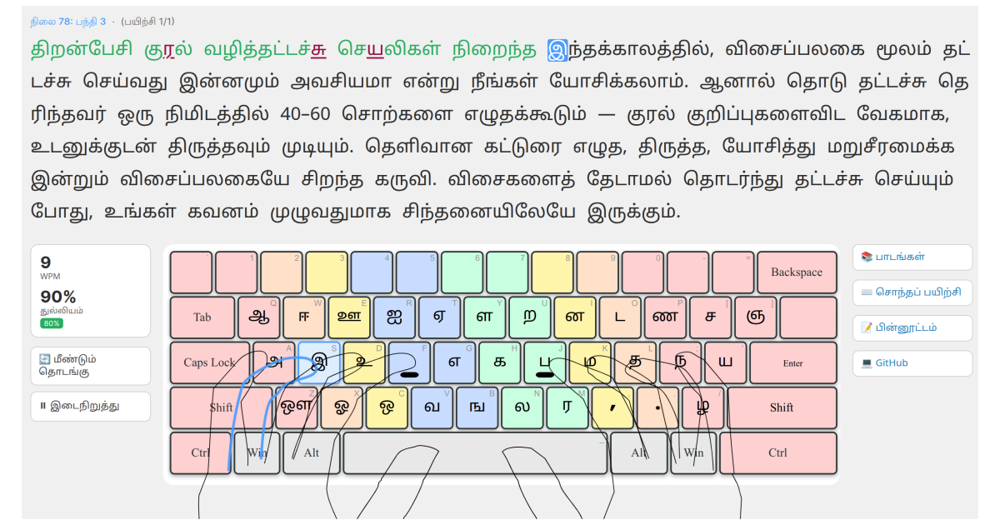

[English](README.md) | [தமிழ்](README.ta.md)

# eluthu: Master Tamil Touch Typing

**▶ [Let's Start Now](https://ennumezuththum.github.io/eluthu/)** — Free, runs locally in your browser, nothing to install.



**eluthu** is a free, open-source Tamil touch typing tutor for the **Tamil 99** keyboard layout.

Back in 2015, a touch typing tutor transformed my English typing skills. I went from hunt-and-peck typing at 20 words per minute to effortlessly typing with ten fingers at over 80 words per minute without looking at the keyboard, thanks to [TypingClub](https://www.typingclub.com/).

When I noticed a lack of similar dedicated tools for Tamil, I decided to build **eluthu**. Below you'll find what it offers, why it teaches Tamil 99, and why touch typing is worth learning.

---

## Key Features

- **Progressive Lessons:** A step-by-step curriculum that builds muscle memory naturally.
- **Three Levels:**
  - **Beginner:** the pulli (்), vowels (e.g. அ) and consonants with the inherent "a" (e.g. க).
  - **Intermediate:** pure consonants (e.g. க்) and other vowel-consonants (e.g. கா).
  - **Advanced:** sentences and paragraphs.
- **Finger-Position Learning:** Keys are introduced in ergonomic pairs based on home-row positioning rather than alphabetical order. (Your first two keys are **ப** via `J` and **்** pulli via `F`.)
- **Visual Keyboard Guidance:** A colour-coded on-screen keyboard shows which finger to use for each key and highlights the next key in white, while a hand diagram shows the finger to press it with. Only unlocked or currently practised keys are visible to prevent cognitive overload.
- **Grammar Integration:** After the vowels, consonants are introduced alongside the high-efficiency grammar flows built into Tamil 99.
- **Interactive Messages:** Instructional screens between lessons guide you through the learning journey.
- **Introduction, Practice & Review:** Each new key has two phases, introduction and practice, with review exercises in between. In the introduction, the cursor won't move until you press the right key; practice needs 90%+ accuracy and review 80%+, so you build confidence before moving on.
- **Real Tamil Words:** Combination lessons use real Tamil words and phrases built strictly from characters you have already learned.
- **Local Progress Saving:** Your progress in each lesson is saved automatically in your browser and shown in graphs.
- **Progress Tracking:** A streak heatmap, achievement badges and lesson star ratings — see [Track Your Progress](#track-your-progress).
- **Tamil99 Writer:** A standalone, lightweight Tamil word processor for writing freely — see [Tamil99 Writer](#tamil99-writer).

> **Note:** Grantha characters (ஸ, ஷ, ஜ, ஹ, க்ஷ) and numbers are not yet supported. They are on the [Roadmap](#roadmap).

---

## Why Tamil 99?

There are several Tamil keyboard layouts. The three best-known are **Tamil 99**, **Bamini** and **Anjal Phonetic**.

- **Anjal Phonetic** follows a "type as you speak" approach — English letters map to similar-sounding Tamil characters (for example, கா = k + A [Key K + Shift + Key A]). This makes it intuitive for beginners.

- **Bamini** closely follows traditional Tamil typewriter conventions (for example, கா = க [Key i] + ா [Key m]).

- **Tamil 99** optimises key placement for fast, logical typing on standard QWERTY keyboards, using a consonant-vowel pattern (for example, கா = க [Key H] + ஆ [Key Q]). It relies on three design principles:

   1. **Shorter finger movement:** Keys are arranged by how frequently letters occur in Tamil, so finger movement is minimised.
   2. **Fewer keystrokes:** Tamil words often have a consonant followed by the same consonant (as in அ**ம்மம்மா**), or a soft consonant followed by its matching hard consonant (as in த**ம்பி**). In these cases you don't type the pulli — Tamil 99 adds it automatically (for example, the **க்க** in **வணக்கம்**).
   3. **Minimal `Shift` usage:** To reduce finger strain, `Shift` is needed only for Grantha characters and rare symbols.

Tamil 99 is also the official standard keyboard layout of the Tamil Nadu government, approved in 1999 (see [Resources & References](#resources--references)).

### Layout Comparison

Typing the word **வணக்கம்**:

| Layout | Keystrokes | Unique Keys | Requires `Shift` Key? |
| :--- | :---: | :---: | :---: |
| **Tamil 99** | **6** | **5** | **No** |
| Bamini | 7 | 5 | No |
| Anjal Phonetic | 8 | 6 | Yes |

Tamil 99 needs the fewest keystrokes, and because it is designed around Tamil grammar, it is generally preferred for natural, fast touch typing.

---

## Why Learn Touch Typing?

### Why type on a keyboard at all?

You might wonder why typing on a keyboard is still necessary in the era of smartphones and voice-to-text tools.

Voice dictation works well for quick notes, but serious writing requires editing, refining and restructuring — tasks that demand manual input. If you write regularly, typing efficiently on a physical keyboard remains essential.

### What is touch typing?

Touch typing is the ability to type on a computer keyboard using all ten fingers without looking down at the keys.

| | Touch typing | Hunt-and-peck |
| :--- | :--- | :--- |
| **Hands** | Fingers, wrists and hands stay relaxed. The workload is shared across all ten fingers with minimal movement, reducing the risk of repetitive strain injury (RSI). | Hands hover in the air while your arms move across the keyboard, putting unnecessary strain on your joints. |
| **Eyes & posture** | Your eyes stay on the screen, so you sit upright and catch mistakes instantly. | Looking back and forth between keyboard and screen leads to a craned neck, hunched shoulders and a curved back, causing neck, back and eye strain. |
| **Mind** | Your fingers find keys from muscle memory, so your mind stays on what you are writing. | Your brain constantly switches between what to write, where the keys are, and checking for errors, which breaks concentration and causes mental fatigue. |

### Benefits of touch typing

1. **Better ergonomics and posture:** Less strain and fatigue in your fingers, wrists, arms, neck, back and eyes.
2. **Higher-quality writing:** With your attention on your ideas rather than the keys, your writing flows seamlessly.
3. **Faster speed:** Once muscle memory takes over, your fingers hit keys significantly faster.
4. **Greater accuracy:** Muscle memory leads to fewer typos, and because your eyes are on the screen, you fix mistakes immediately.
5. **Accessibility:** Touch typing lets visually impaired people type fluently without seeing the keyboard.

### What does it take to learn?

* **Regular practice:** With 15 minutes of practice every day, your brain learns to direct your fingers automatically (muscle memory). I recommend keeping this up for six weeks, though progress varies by person.
* **Patience:** Don't worry if your fingers stumble. High speeds won't happen overnight, and at first your typing speed will drop temporarily — stay motivated and stay patient.
* **Eyes on the screen:** The single most important rule of touch typing is never to look at the keyboard.
* **Breaking old habits:** Be prepared to unlearn old hunt-and-peck finger movements.
* **Accuracy over speed:** Focus on accuracy — speed comes naturally with practice.
* **No special hardware:** You don't need to buy a Tamil keyboard or stick Tamil letters on your keys; your ordinary QWERTY keyboard is enough. To type in Tamil outside eluthu, enable the Tamil 99 layout in your operating system. It's easy on any OS, and if you need help setting it up, contact us via the [feedback form](https://forms.gle/uwwtEWPmU6NVf6QaA).

---

## Tamil99 Writer

A dedicated writing space, completely separate from the lesson curriculum — for letters, notes, school newsletters, or anything else you want to write in Tamil, not just practice text.

- **Type freely** using Tamil 99, with copy and paste both ways (button or native Ctrl+V/Cmd+V) to move text in and out of the box.
- **Real cursor editing** — move with the arrow keys (Left/Right, Home/End), insert or delete text anywhere, not just at the end.
- **Auto-save** — your draft saves itself a second after you stop typing, with a small "Saved ✓" indicator, and is restored automatically the next time you open the page, even after a hard refresh.

Anything you write here doesn't count towards your streak, badges or lesson stars.

---

## Track Your Progress

eluthu helps you track your progress over time — all computed locally from your own practice data, nothing sent anywhere.

- **🔥 Streak & Heatmap:** A GitHub-style contribution graph shows which days you practised, with a running streak counter for consecutive days. Click any day on the heatmap for a detailed breakdown — exercises completed, average speed and accuracy for that day.
- **🏅 Badges:** Unlockable achievements across several categories — daily practice duration, streak length, typing speed, accuracy, keyboard-row completion, character-set completion, and content milestones (first word, sentence, paragraph). Badges appear on the heatmap on the day you earn them.
- **⭐ Lesson Stars:** Each lesson is rated 1–5 stars based on your best performance. Redoing a lesson can only improve its rating, never lower it — so there's no risk in going back to sharpen a skill.

---

## Privacy & Security

eluthu is designed to be completely private:

- **Zero Data Transmission:** Nothing you type ever leaves your device. All processing happens in your browser.
- **No Accounts Needed:** No registration, login or personal details required.
- **Local Storage Only:** Progress is saved locally in your browser (`localStorage`). Clearing your browser data resets your progress.
- **Ad-Free & Tracker-Free:** No ads, analytics or third-party tracking scripts.
- **Open Source:** Licensed under the MIT License — all source code is publicly auditable in this repository.

---

## Roadmap

The following feature is planned for future releases:

1. Full support for Grantha characters (ஸ, ஷ, ஜ, ஹ, க்ஷ) and numbers.

---

## How You Can Help

- **Use & Share:** Try eluthu and share it with friends, family, students, writers, or anyone learning Tamil.
- **Provide Feedback:** Submit bug reports or feature requests via our [Quick Feedback Form](https://forms.gle/uwwtEWPmU6NVf6QaA) or [GitHub Issues](https://github.com/eNNumEzuththum/eluthu/issues). Please include the version number shown in the app.
- **Contribute Content:** Help expand our word database and lesson exercises — see [Regenerating lessons](#regenerating-lessons).
- **Contribute Code or Design:** Pull requests are always welcome!

**Contact:** [enn.eluththu@gmail.com](mailto:enn.eluththu@gmail.com)

---

## Developer Notes

### Run locally

1. Clone the repository:
   ```bash
   git clone https://github.com/eNNumEzuththum/eluthu.git
   cd eluthu
   ```
2. Start a local server:
   ```bash
   python3 -m http.server 8080
   ```
3. Open http://localhost:8080 in your web browser.

### Regenerating lessons

Lessons are generated from two hand-edited sources: `lesson_plan.json` (lesson definitions) and `words.txt` (frequently used Tamil words).

```bash
python3 add_words_to_lesson.py   # lesson_plan.json + words.txt → lesson_words.json
python3 generate_lessons.py      # lesson_words.json → data/lessons.json + data/exercises/
```

### Code Structure

```text
.
├── index.html                # Main entry point for the web application
├── tamil99-writer.html       # Standalone Tamil99 word processor — separate from lesson progress
├── css/
│   └── style.css             # Application styles
├── js/
│   ├── tamil99.js            # Tamil 99 layout rules and character mapping
│   ├── combination.js        # Keystroke stream engine for combination typing
│   ├── typing.js             # Standard character-by-character typing engine
│   ├── lessons.js            # Lesson loader and progression controller
│   ├── app.js                # Core application orchestrator
│   └── version.js            # Application versioning tracker
├── assets/
│   ├── keyboard.svg          # Keyboard layout diagram with finger guides
│   └── keyboard_all_keys.svg # Dual-labelled keyboard diagram (Tamil + English)
├── data/
│   ├── lessons.json          # Lesson manifest (ordering, metadata, exercise lists)
│   ├── tamil99-keymap.json   # QWERTY to Tamil 99 key bindings
│   └── exercises/
│       └── XX-XX.json        # Individual exercise JSON data files
├── lesson_plan.json          # Minimal hand-edited lesson definitions
├── words.txt                 # Frequently used Tamil word database
├── add_words_to_lesson.py    # Reads lesson_plan.json + words.txt → lesson_words.json
├── lesson_words.json         # Generated: lesson metadata + matched words per lesson
├── generate_lessons.py       # Reads lesson_words.json → data/lessons.json + exercises/
├── TESTS.md                  # Comprehensive test documentation
└── update-tests.sh           # Script to sync version details in TESTS.md
```

---

## Resources & References

- [Wikipedia: Tamil 99 Layout](https://en.wikipedia.org/wiki/Tamil_99)
- [Tamil Nadu Government Keyboard Documentation](https://www.tamilvu.org/tkbd/doc_file/Help_Linux.pdf)
- [Interactive Tamil 99 Layout Map](https://kbdlayout.info/kbdtam99)
- [Tamil 99 Keyboard Help Chart (PDF)](https://help.keyman.com/keyboard/ekwtamil99uni/2.0.5/chart.pdf)
- [W3Tamil Online Tamil 99 Typing](https://wk.w3tamil.com/)
- [TypingClub (English Touch Typing)](https://www.typingclub.com/)

---

## License

Distributed under the MIT License. See LICENSE for details.

Free to use, modify, and distribute. Contributions are welcome!
